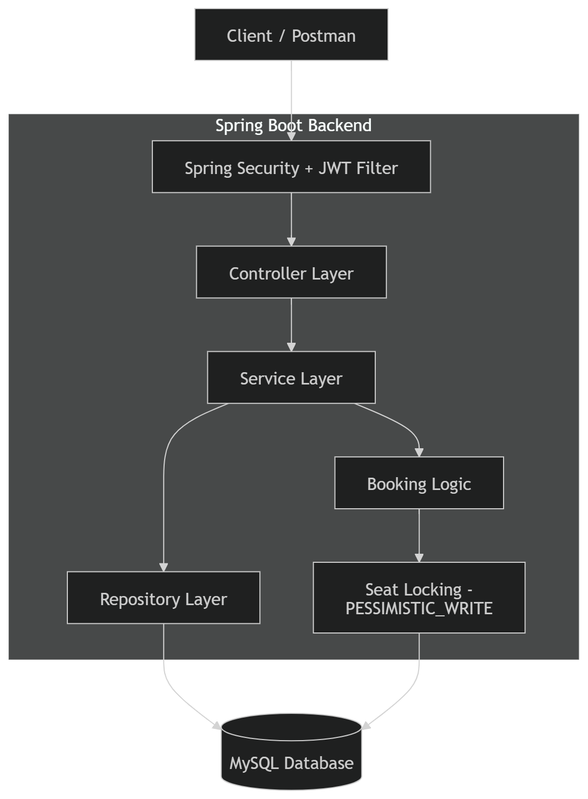
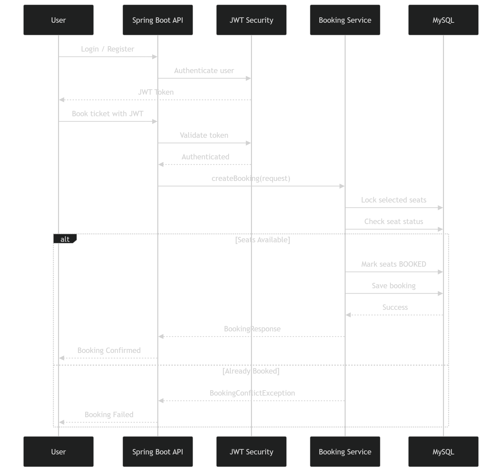
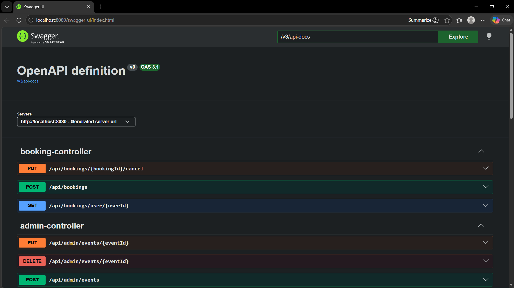
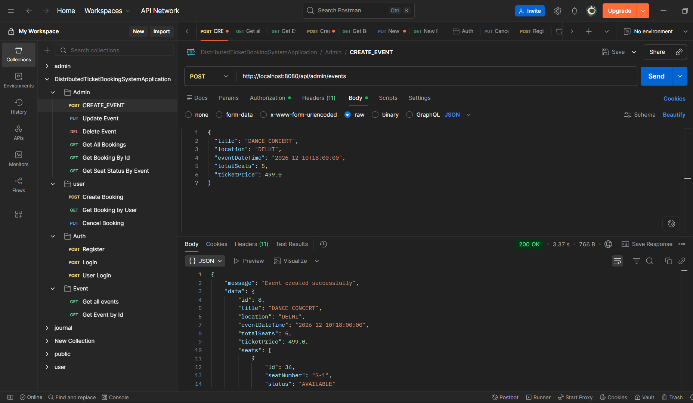

# 🎟️ Distributed Ticket Booking System (Backend)
> A production-ready backend system demonstrating secure authentication and concurrency-safe booking using database-level locking.

A backend-only distributed ticket booking system built using **Spring Boot**, **MySQL**, and **JWT Authentication**.  
The system supports secure ticket booking with concurrency control to prevent overbooking.

---
## 📌 Project Overview

The Distributed Ticket Booking System is a backend application designed to simulate a real-world ticket reservation platform. It allows users to browse events, select seats, and book tickets securely.

The system focuses on handling **concurrent booking scenarios**, where multiple users may try to book the same seat at the same time. To prevent issues like overbooking, the application uses **ACID-compliant transactions** along with **database-level pessimistic locking**.

This project follows a clean layered architecture using Spring Boot, where each layer (Controller, Service, Repository) has a clear responsibility. It also integrates **JWT-based authentication and role-based authorization**, ensuring secure access for both users and administrators.


---

## 🎯 Key Objectives

- Build a scalable and secure backend system for ticket booking
- Prevent double booking using transaction management
- Implement role-based access control (Admin & User)
- Design RESTful APIs for real-world use cases
- Ensure data consistency under concurrent requests

---

## 🧠 How It Works (Simple Flow)

1. User registers and logs in to get a JWT token
2. User fetches available events
3. User selects seats for an event
4. System locks selected seats at database level
5. System checks if seats are already booked
6. If available → booking is confirmed
7. If not → request fails (no overbooking)

---

## 💡 Why This Project is Important

In real-world systems like movie booking or flight reservation platforms, handling **concurrent requests** is critical. Without proper locking, multiple users can book the same seat, leading to inconsistent data.

This project solves that problem using:
- Transaction management (`@Transactional`)
- Pessimistic locking (`PESSIMISTIC_WRITE`)
- Proper validation and exception handling

---
## 🚀 Highlights

- 🔐 Secure JWT-based authentication
- ⚡ Concurrency-safe booking system
- 🧠 Clean layered architecture
- 🗄️ Efficient database design with JPA/Hibernate
- 📡 RESTful APIs with proper validation and exception handling
---
## 🏗️ Architecture Diagram

### 📌 Explanation
* Controller Layer → Handles REST APIs
* Service Layer → Business logic (booking, validation)
* Repository Layer → JPA/Hibernate DB operations
* Security Layer → JWT authentication & authorization
* Database → MySQL stores users, events, bookings, seats
* Concurrency Control → Pessimistic locking prevents overbooking
---
## 🔄 Booking Flow Diagram

---
### 🔄 Flow

User → Login → Get Token → Select Seats → Lock Seats → Validate → Save Booking → Response

---
## 🚀 Features

### 🔐 Authentication & Authorization

* User Registration & Login
* JWT-based authentication
* Role-based access:

   * **ADMIN**
   * **USER**

---

### 🎫 Event Management (Admin)

* Create Event
* Update Event
* Delete Event
* View all bookings
* View booking by ID
* Check seat status for events

---

### 🧑‍💻 User Booking

* Book tickets (multiple seats)
* View own bookings
* Cancel booking

---

### 🎭 Event APIs

* Get all events
* Get event by ID

---

### ⚡ Concurrency Handling

* ACID-compliant transactions
* Prevents double booking of seats
* Uses database-level locking (JPA/Hibernate)

---

## 🛠️ Tech Stack

* **Backend:** Java, Spring Boot
* **Database:** MySQL
* **ORM:** JPA / Hibernate
* **Security:** Spring Security + JWT
* **Testing:** Postman
* **Build Tool:** Maven

---

## 📁 Project Structure

```
src/main/java/com/shubhdeep/ticketbooking
 ┣ config
 ┣ controller
 ┣ dto
 ┣ entity
 ┣ enums
 ┣ exception
 ┣ repository
 ┣ security
 ┣ service
```
---

## API Documentation

Swagger UI:

http://localhost:8080/swagger-ui.html

Swagger Preview-


## API Testing (Postman)

 Postman Preview-


---

## ⚙️ Setup Instructions

### 1. Clone the Repository

```bash
git clone https://github.com/YOUR_USERNAME/distributed-ticket-booking-system-backend.git
cd distributed-ticket-booking-system-backend
```

---

### 2. Configure MySQL

Create a database:

```sql
CREATE DATABASE ticket_booking;
```

Update `application.properties`:

```properties
spring.datasource.url=jdbc:mysql://localhost:3306/ticket_booking
spring.datasource.username=root
spring.datasource.password=your_password

spring.jpa.hibernate.ddl-auto=update
```

---

### 3. Run the Application

Using IntelliJ or:

```bash
mvn spring-boot:run
```

Server will start at:

```
http://localhost:8080
```

---

## 🔑 Authentication Flow

1. Register user → `/auth/register`
2. Login → `/auth/login`
3. Copy JWT token from response
4. Add in headers:

```
Authorization: Bearer <token>
```

---

## 📬 API Endpoints Overview

### 🔐 Auth

* `POST /auth/register`
* `POST /auth/login`

---

### 🎭 Events

* `GET /api/events`
* `GET /api/events/{id}`

---

### 🎫 Booking (User)

* `POST /api/bookings`
* `GET /api/bookings/my`
* `PUT /api/bookings/{id}/cancel`

---

### 🛠️ Admin

* `POST /api/admin/events`
* `PUT /api/admin/events/{id}`
* `DELETE /api/admin/events/{id}`
* `GET /api/admin/bookings`
* `GET /api/admin/bookings/{id}`
* `GET /api/admin/events/{id}/seats`

---

## 🧪 Postman Collection

Postman files are available in:

```
postman/
```

### Files:

* `ticket-booking-system.postman_collection.json`
* `ticket-booking-system.postman_environment.json`

### Setup:

1. Import both files into Postman
2. Select environment: `ticket-booking-system-local`
3. Set:

```
baseUrl = http://localhost:8080
```

4. Login → token auto-saved or paste manually

---

## 🧠 Key Concepts Used

* JWT Authentication
* Role-Based Authorization
* REST API Design
* Transaction Management
* Exception Handling
* DTO Pattern
* Clean Architecture

---

## 📌 Future Improvements

* Dockerization
* Redis caching for seat locking
* Rate limiting
* Email notifications

---

## 👨‍💻 Author

**Shubhdeep Varshney**

Email: shubhdeepvarshney02@gmail.com

---

## ⭐ If you like this project

Give it a ⭐ on GitHub!
