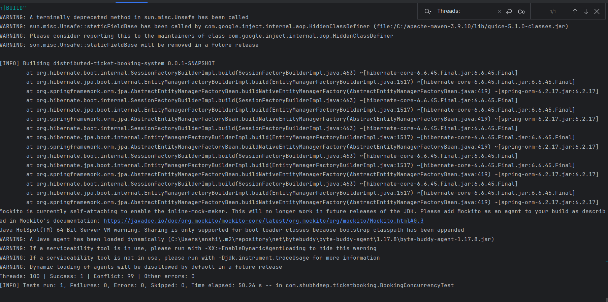
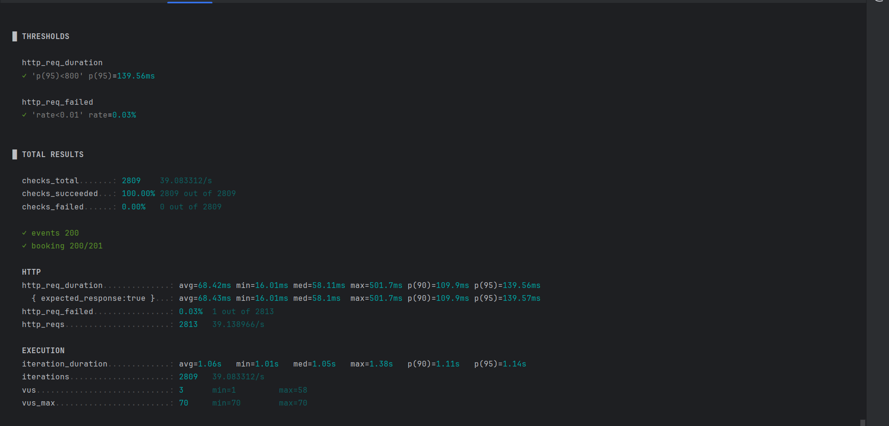
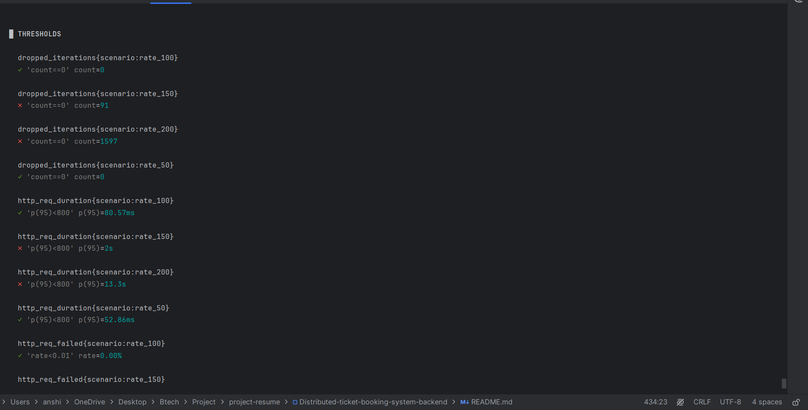

# 🎟️ Ticket Booking System (Backend)
> A production-ready backend system demonstrating secure authentication and concurrency-safe booking using database-level locking.

A backend-only distributed ticket booking system built using **Spring Boot**, **MySQL**, and **JWT Authentication**.
The system supports secure ticket booking with concurrency control to prevent overbooking, and it has been tested for concurrent booking and load.

---
## 📌 Project Overview

The Distributed Ticket Booking System is a backend application designed to simulate a real-world ticket reservation platform. It allows users to browse events, select seats, and book tickets securely.

The system focuses on handling **concurrent booking scenarios**, where multiple users may try to book the same seat at the same time. To prevent issues like overbooking, the application uses **ACID-compliant transactions** along with **database-level pessimistic locking**.

This project follows a clean layered architecture using Spring Boot, where each layer (Controller, Service, Repository) has a clear responsibility. It also integrates **JWT-based authentication and role-based authorization**, ensuring secure access for both users and administrators.

---

## 🎯 Key Objectives

- Build a scalable and secure backend system for ticket booking
- Prevent double booking using transaction management
- Implement role-based access control (Admin & User)
- Design RESTful APIs for real-world use cases
- Ensure data consistency under concurrent requests
- Measure concurrency correctness and throughput with automated tests

---

## 🧠 How It Works (Simple Flow)

1. User registers and logs in to get a JWT token
2. User fetches available events
3. User selects seats for an event
4. System locks selected seats at database level
5. System checks if seats are already booked
6. If available → booking is confirmed
7. If not → request fails (no overbooking)

---

## 💡 Why This Project is Important

In real-world systems like movie booking or flight reservation platforms, handling **concurrent requests** is critical. Without proper locking, multiple users can book the same seat, leading to inconsistent data.

This project solves that problem using:
- Transaction management (`@Transactional`)
- Pessimistic locking (`SELECT ... FOR UPDATE`, `PESSIMISTIC_WRITE`)
- Proper validation and exception handling

---

## 🚀 Highlights

- 🔐 Secure JWT-based authentication
- ⚡ Concurrency-safe booking system, verified by a 100-thread test
- 🧠 Clean layered architecture
- 🗄️ Efficient database design with JPA/Hibernate
- 📡 RESTful APIs with proper validation and exception handling
- 📊 Load tested with k6: 100 req/s sustained in 30-second bursts, p95 under 40 ms

---

## 🏗️ Architecture Diagram
.

### 📌 Explanation
* Controller Layer → Handles REST APIs
* Service Layer → Business logic (booking, validation)
* Repository Layer → JPA/Hibernate DB operations
* Security Layer → JWT authentication & authorization
* Database → MySQL stores users, events, bookings, seats
* Concurrency Control → Pessimistic locking prevents overbooking

---

## 🔄 Booking Flow Diagram


---

### 🔄 Flow

User → Login → Get Token → Select Seats → Lock Seats → Validate → Save Booking → Response

---

## 🚀 Features

### 🔐 Authentication & Authorization

* User Registration & Login
* JWT-based authentication
* Role-based access:
    * **ADMIN**
    * **USER**

---

### 🎫 Event Management (Admin)

* Create Event
* Update Event
* Delete Event
* View all bookings
* View booking by ID
* Check seat status for events

---

### 🧑‍💻 User Booking

* Book tickets (multiple seats)
* View own bookings
* Cancel booking

---

### 🎭 Event APIs

* Get all events
* Get event by ID

---

### ⚡ Concurrency Handling

* ACID-compliant transactions
* Prevents double booking of seats
* Uses database-level pessimistic locking (JPA/Hibernate)

---

## 🛠️ Tech Stack

* **Backend:** Java 17, Spring Boot
* **Database:** MySQL 8
* **ORM:** JPA / Hibernate
* **Security:** Spring Security + JWT
* **Containers:** Docker, Docker Compose
* **API Docs:** Swagger / OpenAPI (springdoc)
* **Testing:** JUnit 5, Testcontainers, Postman, k6
* **Build Tool:** Maven

---

## 📁 Project Structure

```
src/main/java/com/shubhdeep/ticketbooking
 ┣ config
 ┣ controller
 ┣ dto
 ┣ entity
 ┣ enums
 ┣ exception
 ┣ repository
 ┣ security
 ┣ service

src/test/java/com/shubhdeep/ticketbooking
 ┗ BookingConcurrencyTest.java

load-tests/
 ┣ load-test.js
 ┣ stress-test.js
 ┗ step-test.js
```

---

## API Documentation

Swagger UI:

http://localhost:8080/swagger-ui.html

Swagger Preview:


## API Testing (Postman)

Postman Preview:


---

## ⚙️ Setup Instructions

### 1. Clone the Repository

```bash
git clone https://github.com/YOUR_USERNAME/distributed-ticket-booking-system-backend.git
cd distributed-ticket-booking-system-backend
```

---

### 2. Configure MySQL

Create a database:

```sql
CREATE DATABASE ticket_booking;
```

Update `application.properties`:

```properties
spring.datasource.url=jdbc:mysql://localhost:3306/ticket_booking
spring.datasource.username=root
spring.datasource.password=your_password

spring.jpa.hibernate.ddl-auto=update
```

---

### 3. Run the Application

Using IntelliJ or:

```bash
mvn spring-boot:run
```

Server will start at:

```
http://localhost:8080
```

---

## 🐳 Run with Docker

- Step 1: Install Docker Desktop
- Step 2: Run project:
```bash
  docker compose up --build
```
- Step 3: Open Swagger: http://localhost:8080/swagger-ui/index.html

---

## 🔑 Authentication Flow

1. Register user → `/auth/register`
2. Login → `/auth/login`
3. Copy JWT token from response
4. Add in headers:

```
Authorization: Bearer <token>
```

---

## 📬 API Endpoints Overview

### 🔐 Auth

* `POST /auth/register`
* `POST /auth/login`

---

### 🎭 Events

* `GET /api/events`
* `GET /api/events/{id}`

---

### 🎫 Booking (User)

* `POST /api/bookings`
* `GET /api/bookings/my`
* `PUT /api/bookings/{id}/cancel`

---

### 🛠️ Admin

* `POST /api/admin/events`
* `PUT /api/admin/events/{id}`
* `DELETE /api/admin/events/{id}`
* `GET /api/admin/bookings`
* `GET /api/admin/bookings/{id}`
* `GET /api/admin/events/{id}/seats`

---

## 🧪 Postman Collection

Postman files are available in:

```
postman/
```

### Files:

* `ticket-booking-system.postman_collection.json`
* `ticket-booking-system.postman_environment.json`

### Setup:

1. Import both files into Postman
2. Select environment: `ticket-booking-system-local`
3. Set:
```
   baseUrl = http://localhost:8080
```
4. Login → token auto-saved or paste manually

---

## 🧠 Key Concepts Used

* JWT Authentication
* Role-Based Authorization
* REST API Design
* Transaction Management
* Pessimistic Locking
* Exception Handling
* DTO Pattern
* Clean Architecture
* Concurrency Testing (Testcontainers)
* Load and Stress Testing (k6)

---

## 🧪 Testing & Performance

### Concurrency test (no double booking)
A JUnit + Testcontainers test starts a real MySQL 8.0 container and fires 100 threads at the same seat at the same moment. The booking query uses `SELECT ... FOR UPDATE` (pessimistic locking) inside a transaction.

| Result | Value |
|---|---|
| Threads | 100 |
| Successful bookings | 1 |
| Rejected (conflict) | 99 |
| Double bookings | 0 |



Run it with:
```bash
mvn test -Dtest=BookingConcurrencyTest

 mvn test -Dtest=BookingConcurrencyTest | Select-String "Threads:|Tests run|BUILD"

```
### Load test (k6)
Simulates 50 users browsing events and 20 users booking seats at the same time (70 virtual users in total).

| Metric | Result |
|---|---|
| Virtual users | 70 |
| Total requests | 2,813 |
| p95 latency | 139.56 ms |
| Average latency | 68.42 ms |
| Error rate | 0.03% (1 of 2,813 requests) |
| Bookings succeeded | 200 of 200 |



Run it with:
```bash
k6 run load-tests/load-test.js
```

### Throughput (k6 step test)
Requests were sent at fixed rates for 30 seconds per step, on a single laptop (app, MySQL and k6 all on the same machine). Each step is a short burst, not a long-duration soak test, so these numbers are a lower bound.

| Rate (req/s) | p95 latency | Error rate | Dropped requests | Result |
|---|---|---|---|---|
| 50 | 52.86 ms | 0.00% | 0 | Met target (p95 < 800 ms, no drops) |
| 100 | 80.57 ms | 0.00% | 0 | Met target (p95 < 800 ms, no drops) |
| 150 | 2.00 s | 0.00% | 91 | Exceeded target |
| 200 | 13.30 s | 0.00% | 1,597 | Exceeded target |

**Sustained throughput (measured over 30-second bursts): ~100 req/s** on `GET /api/events`, with p95 under 81 ms and zero errors. Longer soak tests were not run, so this does not show stability over hours.



Run it with:
```bash
k6 run load-tests/step-test.js
```


### Stress test (k6)
Requests were ramped from 50 to 800 req/s over 110 seconds on a single laptop, with a cap of 250 virtual users. The app returned no errors, but latency rose sharply as the rate increased. k6 ran out of virtual users and dropped 19,200 iterations, which shows the server could not keep up with the requested rate.

| Metric | Result |
|---|---|
| Requests completed | 19,299 |
| Error rate | 0.00% |
| Average achieved rate | ~175 req/s (includes the ramp-up and ramp-down) |
| p95 latency | 2.21 s (above the 800 ms target) |
| Dropped iterations | 19,200 |

The average rate is higher than the step test's 100 req/s because it includes the lower-rate stages of the ramp. The p95 latency is the limit that matters: it stayed under 800 ms only at the lower rates measured in the step test, so the sustainable throughput is about 100 req/s on this machine.

Run it with:
```bash
k6 run load-tests/stress-test.js
```

---

## 📌 Future Improvements

* Redis caching for seat locking
* Rate limiting
* Email notifications
* Pagination for event and booking lists
* GitHub Actions CI pipeline to run tests on every push

---

## 👨‍💻 Author

**Shubhdeep Varshney**

Email: shubhdeepvarshney02@gmail.com

---

## ⭐ If you like this project

Give it a ⭐ on GitHub!